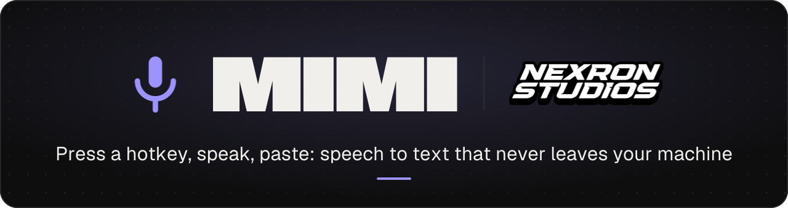

<div align="center">

<picture>
  <source media="(prefers-color-scheme: dark)" srcset="docs/brand/readme-banner-dark.svg">
  <source media="(prefers-color-scheme: light)" srcset="docs/brand/readme-banner-light.svg">
  
</picture>

<br><br>


</div>

<br>

**Mimi** ist eine kleine, **komplett lokale** Desktop-App zum schnellen Aufnehmen, Transkribieren und Kopieren von Sprache.

> Aufnahme starten → sprechen → stoppen → lokale Transkription → Text automatisch in der Zwischenablage → überall einfügen.

Keine Cloud, keine API, kein Browser nötig. Alle Daten (Transkripte) liegen lokal in einer SQLite-Datei im App-Data-Verzeichnis.

## Features

- Kleines Fenster mit minimalistischem UI und weißem Branding
- Aufnahme per Button **oder** globalem Hotkey (Standard: `Strg+Shift+Leertaste`)
- Automatische, lokale Transkription via **Whisper** (whisper.cpp)
- Automatisches Kopieren in die Zwischenablage
- Durchsuchbarer Verlauf früherer Transkripte (Fuzzy-Suche)
- Hell/Dunkel-Theme, Deutsch/Englisch (i18n), animierter Three.js-Hintergrund

## Tech-Stack

| Bereich     | Technologie                                                             |
| ----------- | ----------------------------------------------------------------------- |
| Frontend    | Vue 3 (`<script setup>`), TypeScript, Vite 8, Pinia, Vue Router         |
| Styling/UI  | Tailwind CSS v4, shadcn/vue, Reka UI, Lucide Icons, Three.js, vue-sonner |
| Runtime     | Tauri 2 (WebView2 auf Windows)                                          |
| Backend     | Rust 2021, SQLite (rusqlite, bundled), whisper-rs                       |

## Voraussetzungen

- Node.js 20+ und npm
- Rust (stable, MSVC-Toolchain unter Windows)
- **CMake** und **Ninja** (für den whisper.cpp-Build)
- **LLVM** (liefert `libclang.dll`, von `bindgen` benötigt)

### Windows-Hinweis

Der `whisper-rs-sys`-Build benötigt `libclang` (bindgen) und einen CMake-Generator.
Auf diesem Rechner ist VS 18 (2026 Insiders) installiert, das ältere CMake-Versionen
nicht als VS-Generator kennen – deshalb wird **Ninja** erzwungen. Beide Werte sind in
`src-tauri/.cargo/config.toml` hinterlegt (gitignored, ggf. Pfade anpassen):

```toml
[env]
LIBCLANG_PATH = "C:\\Program Files\\LLVM\\bin"
CMAKE_GENERATOR = "Ninja"
```

## Entwicklung

```bash
npm install
npm run app:dev      # Tauri-Dev (startet Vite + öffnet das Fenster)
```

Beim ersten Start lädt die App einmalig das Whisper-Modell (`ggml-base`, ~148 MB)
in das App-Data-Verzeichnis herunter. Danach läuft die Transkription vollständig offline.

## Build

```bash
npm run app:build    # Erzeugt Installer (NSIS/MSI) in src-tauri/target/release/bundle
```

## Projektstruktur

```
src/
  components/    # NxrLogo, NxrBackground (Three.js), NxrMicButton, NxrNav, ui/ (shadcn)
  services/      # transcription.service.ts, history.service.ts (Tauri-IPC-Wrapper)
  stores/        # recorder.ts, transcripts.ts, settings.ts (Pinia)
  views/         # RecordView, HistoryView, SettingsView
  utils/         # audio.ts (Mic → 16 kHz Mono PCM), tauri.ts
  i18n/          # DE/EN
src-tauri/
  src/           # lib.rs (Commands), db.rs (SQLite), transcribe.rs (whisper), model.rs (Download)
```

<br>

<div align="center"><sub>Mimi is a NEXRON Studios tool. Banner from docs/brand/banner.json; the violet is the primary token in src/styles/shadcn.css.</sub></div>
